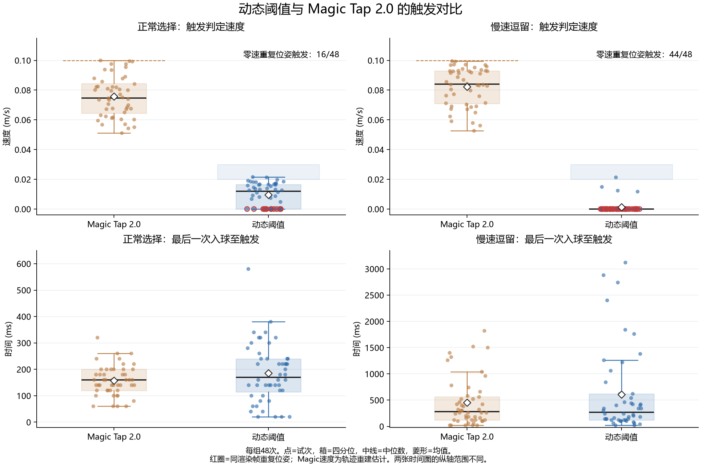

# 动态阈值与 Magic Tap 2.0：触发速度及触发时间

分析对象：4个独立采集会话，每个会话48条完成试次（ID 1、2、3各16条），合计192条。动态模式为 `ixdlDynamic`。

## 主要结果

|情境|模式|判定速度均值 (m/s)|判定速度中位数 (m/s)|触发时间均值 (ms)|触发时间中位数 (ms)|触发时间P95 (ms)|
|---|---|---:|---:|---:|---:|---:|
|正常选择|Magic Tap 2.0|0.0757|0.0747|158|160|253|
|正常选择|动态阈值|0.0096|0.0119|186|170|340|
|慢速逗留|Magic Tap 2.0|0.0822|0.0840|451|280|1465|
|慢速逗留|动态阈值|0.0013|0.0000|608|270|2621|

**速度口径：** 动态阈值使用 `ixdl-trigger` 中触发前保存的精确判定速度；Magic Tap 2.0 未单独保存触发速度，按对齐的轨迹位置及其1毫米过滤规则重建，属于估计值，保留4位小数仅便于复核，不代表该精度的测量能力。

**时间口径：** `time.csv` 的 `triggerTime`，从最后一次入球到触发，包含20 ms固定步量化；不等于从上一个目标到本次触发的整次用时，多次出入球时也不等于第一次入球后的总等待时间。P95按线性插值计算。

## 正常选择

Magic Tap 2.0的平均触发等待为157.5 ms，动态阈值为185.8 ms，动态阈值多28.3 ms（18.0%）。中位数只差10 ms，但动态阈值P95增加87 ms，标准差113 ms，约为Magic Tap 2.0的56 ms的2倍，说明等待更不稳定。

200 ms内触发：Magic Tap 2.0为41/48（85.4%），动态阈值为27/48（56.3%）。整次选择平均用时分别为0.970 s、1.281 s；这0.311 s差异同时包含入球前的运动时间和行为差异，不能全部归因于触发算法。

## 慢速逗留

动态阈值的平均触发等待为607.9 ms，Magic Tap 2.0为451.3 ms，多156.7 ms（34.7%）。但中位数分别为270 ms和280 ms，动态阈值反而早10 ms。动态阈值的P95为2.621 s，Magic Tap 2.0为1.465 s，均值差主要来自较长的尾部。

200 ms内触发：动态阈值21/48（43.8%），Magic Tap 2.0为19/48（39.6%）；500 ms内触发：动态阈值34/48（70.8%），Magic Tap 2.0为33/48（68.8%）。因此当前数据没有显示动态阈值能稳定推迟慢速逗留触发。

慢速逗留中两种模式均有25/48条完成试次记录了多次入球；动态阈值累计取消53次，Magic Tap 2.0为36次。整次用时均值分别为2.367 s和1.844 s。只看最后一次入球的triggerTime会遗漏前面退出、再进入的成本。

## 最重要的采样问题：动态阈值被重复位姿的零速触发

|情境|动态阈值零速触发|其中与前一物理步同渲染帧|零速前一采样的速度均值 (m/s)|
|---|---:|---:|---:|
|正常选择|16/48 (33.3%)|16/16|0.277|
|慢速逗留|44/48 (91.7%)|44/44|0.295|

这60个零速事件全部发生于同一渲染帧中的连续FixedUpdate。前一步速度仍明显非零，而下一物理步没有新的手部位姿，位置差为0，动态模式便计算出速度0；其有符号加速度同时变为负值，满足加速度小于0.375的条件。

因此这些事件的“速度很低”不能解释为手已经平稳停止。慢速逗留的44/48条（91.7%）尤其受此机制影响。Magic Tap 2.0的1毫米过滤会跳过这种零位移样本，当前两模式对重复位姿的处理并不相同。

敏感性检查：去掉同渲染帧零速事件后，动态阈值正常选择剩32条，平均触发速度0.0145 m/s，平均触发等待223.7 ms；慢速逗留仅剩4条，平均速度0.0151 m/s，平均等待155.0 ms。慢速逗留的有效对照太少，不能据此稳健评价动态机制。这里仅删除已记录的事件，不代表修复算法后会得到相同的触发结果。

## 两种模式的参数与计算口径并不等价

- 本次Magic Tap 2.0速度阈值实际为0.1 m/s，加速度向量模长阈值为11.661 m/s²。
- 动态阈值在触发事件中为0.02038–0.03000 m/s（正常）及0.02052–0.03000 m/s（逗留），均值分别0.02228与0.02449 m/s。记录的前次速度与阈值吻合当前线性映射：`0.02 + 0.01 × clamp(previousSpeed / 0.6, 0, 1)`。
- 动态模式的加速度为有符号速率变化，阈值0.375 m/s²；Magic Tap 2.0使用速度向量变化的模长，并有1毫米位移过滤，且两模式入球区域计算也不同。因此这次结果不能单独归因于“动态阈值”这一因素。

统一采用每个物理步的原始速率（同一口径的ori_v）时，Magic Tap 2.0正常/逗留的均值为0.0669/0.0822 m/s，动态阈值为0.0096/0.0013 m/s。Magic正常选择的重建判定速度均值0.0757 m/s高于原始单步速率，因为过滤后会累计相对上个接受位置的位移，但仍除以一个fixedDeltaTime。两种速度应明确区分。

## 按ID拆分（各16条）

|情境|ID|Magic平均触发时间 (ms)|动态平均触发时间 (ms)|Magic中位时间 (ms)|动态中位时间 (ms)|
|---|---:|---:|---:|---:|---:|
|正常选择|1|186|194|170|160|
|正常选择|2|178|226|180|230|
|正常选择|3|109|138|100|140|
|慢速逗留|1|889|987|850|690|
|慢速逗留|2|358|606|350|200|
|慢速逗留|3|108|230|110|170|

ID间和会话内差异较大。每个组合仅一个会话，未提供被试编号；48次试次不能当作48个独立被试，以上为描述性结果，未作被试层面的显著性推断。

## 数据核对与适用边界

- 192条time记录与192条trial_end按Case/ID一一匹配。动态事件额外的每会话3个开始球触发不属于正式试次，已剔除。
- 96个动态事件的精确速度与按motionFixedTime对齐的ori_v最大误差小于5×10⁻⁹ m/s。轨迹打印比运动样本晚一个20 ms物理步，不能按Case切换后的V_vec直接取触发速度。
- Magic的96个事件经重放均满足双阈值；正常选择Case 47在1毫米边界受坐标舍入影响，使用该试次已记录的历史V_vec状态消除了过滤分支歧义。Magic速度仍是轨迹重建估计，不等于新采集的原始事件值。
- 四组均为50 Hz、timeScale=1；记录的食指尖和远端关节位姿标志均有效，但有效标志不保证每步都有新传感器样本。
- 四组都关闭雷球、随机障碍和预览。文件夹标记了实验情境，但日志没有独立记录“开始逗留/结束逗留/主动选择”的意图时刻。
- 只记录了最终完成的48次触发，缺少全部逗留尝试、未触发尝试及预定逗留时长的分母，不能由此计算逗留误触率。
- time.csv的表头比Fitts16实际数据少6列。分析保留前26列元数据，并从行尾提取4个触发字段；不按错误表头位置提取triggerSpeed，原文件未改动。

## 下一步判断

本次最可信的结果是：Magic Tap 2.0正常选择更快、等待更集中；动态阈值虽在更低的记录速度下触发，却没有形成稳定的逗留等待保护。先避免同一份位姿被重复当作新运动样本，并给Magic增加精确的触发事件快照，再保持速度门限范围、加速度定义和采样规则一致做对照，才能判断动态映射本身的效果。

## 原始数据来源

### MagicTap2.0慢速逗留

- [20261025-16-48-19-time.csv](<D:/动态阈值对比数据/MagicTap2.0慢速逗留/20261025-16-48-19-time.csv>)
- [20261025-16-48-19-session-settings.csv](<D:/动态阈值对比数据/MagicTap2.0慢速逗留/20261025-16-48-19-session-settings.csv>)
- [20261025-16-48-19-trajectory.csv](<D:/动态阈值对比数据/MagicTap2.0慢速逗留/20261025-16-48-19-trajectory.csv>)

### MagicTap2.0正常选择

- [20261025-16-27-21-time.csv](<D:/动态阈值对比数据/MagicTap2.0正常选择/20261025-16-27-21-time.csv>)
- [20261025-16-27-21-session-settings.csv](<D:/动态阈值对比数据/MagicTap2.0正常选择/20261025-16-27-21-session-settings.csv>)
- [20261025-16-27-21-trajectory.csv](<D:/动态阈值对比数据/MagicTap2.0正常选择/20261025-16-27-21-trajectory.csv>)

### 动态阈值慢速逗留

- [20261025-16-50-42-time.csv](<D:/动态阈值对比数据/动态阈值慢速逗留/20261025-16-50-42-time.csv>)
- [20261025-16-50-42-session-settings.csv](<D:/动态阈值对比数据/动态阈值慢速逗留/20261025-16-50-42-session-settings.csv>)
- [20261025-16-50-42-trajectory.csv](<D:/动态阈值对比数据/动态阈值慢速逗留/20261025-16-50-42-trajectory.csv>)
- [20261025-16-50-42-ixdl-trigger.csv](<D:/动态阈值对比数据/动态阈值慢速逗留/20261025-16-50-42-ixdl-trigger.csv>)

### 动态阈值正常选择

- [20261025-15-34-00-time.csv](<D:/动态阈值对比数据/动态阈值正常选择/20261025-15-34-00-time.csv>)
- [20261025-15-34-00-session-settings.csv](<D:/动态阈值对比数据/动态阈值正常选择/20261025-15-34-00-session-settings.csv>)
- [20261025-15-34-00-trajectory.csv](<D:/动态阈值对比数据/动态阈值正常选择/20261025-15-34-00-trajectory.csv>)
- [20261025-15-34-00-ixdl-trigger.csv](<D:/动态阈值对比数据/动态阈值正常选择/20261025-15-34-00-ixdl-trigger.csv>)
