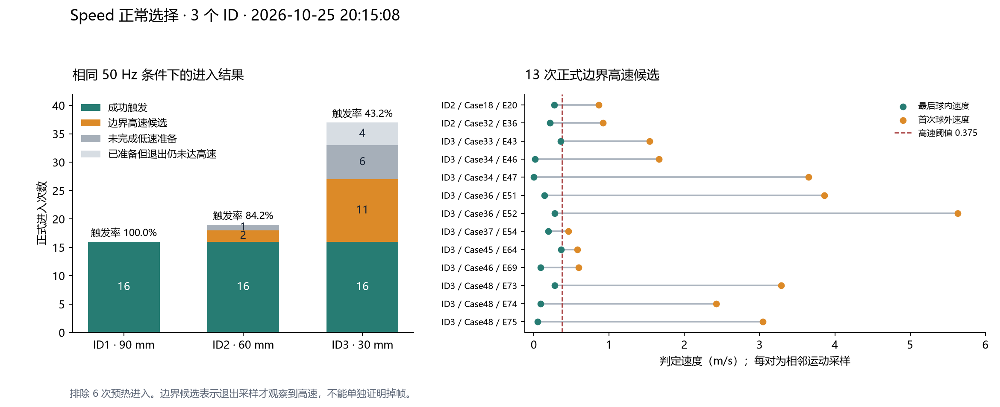

# Speed 正常选择实验：边界高速与未触发退出分析

实验日期：2026-10-25。采集会话：20261025-20-15-08。

## 1. 实验目的与方法

### 1.1 要回答的问题

本实验检查 Study3 的 Speed 选择方式是否存在以下情况：手已经快速抽出目标，但系统直到手离开目标后才记录到达到阈值的速度，因此没有触发选择。分析重点是未触发退出前后的两个相邻运动采样，以及当时是否已经满足 Speed 的准备条件。

### 1.2 实验如何进行

实验使用 Study3 的环形目标选择任务，采用 Fitts16 序列。每个条件先选择开始球，开始球不计入正式试次；随后按程序指定的环上目标顺序完成 16 次选择。环上有 16 个位置，程序每次按设定方向跨 7 个位置切换目标。若一次进入目标后未触发便退出，当前试次继续，重新进入并成功触发后才计为完成一次正式选择。

本次使用 Speed 模式完成 ID1、ID2、ID3 三个条件，每个条件 16 个正式试次，共 48 个。Speed 的操作过程是将手指移入目标，先达到低速准备状态，再通过加速运动触发选择；本分析关注抽手离开目标时的失败记录。三个 ID 是目标条件编号，不是参与者编号，也不是直接计算得到的 Fitts 难度数值。

| 条件 | 目标宽度 | 目标环半径 | 正式试次数 |
|---|---:|---:|---:|
| ID1 | 90 mm | 250 mm | 16 |
| ID2 | 60 mm | 300 mm | 16 |
| ID3 | 30 mm | 350 mm | 16 |

目标宽度和环半径同时变化，因此 ID3 同时涉及较小目标和较大的目标间移动距离。本实验没有把这两个因素分别控制。

三个条件的运动判定频率均为 **50 Hz**，固定时间步长为 **20 ms**，timeScale=1。低速准备阈值为 **0.067 m/s**，高速触发阈值为 **0.375 m/s**；雷球、随机障碍和预览均关闭。虽然原始数据父目录名包含“30hz_50hz_analysis”，本会话实际没有 30 Hz 对照条件。

本报告依据一个采集会话进行描述性分析。日志没有提供可核实的参与者人数和设备型号，因此试次统计不用于参与者总体的显著性推断。

### 1.3 Speed 的判定过程

程序在每次 FixedUpdate（固定时间步回调）读取食指尖位置，用相邻位置的位移除以固定步长计算速度。随后判断手指是否仍在目标判定区域内。食指尖或食指远端关节任一个位于目标碰撞体的世界轴对齐包围盒内，即记为“球内”；两者都在外面才记为退出。因此本文的“球内/球外”指程序实际判定区域，不等同于精确几何球面。

进入后，程序需要先在球内观察到速度 ≤ 0.067 m/s，完成低速准备；准备后再在球内观察到速度 ≥ 0.375 m/s，才触发选择。首次球外采样即使已经达到高速阈值，也只记录退出并结束本次进入状态，不会补触发。

### 1.4 术语与统计口径

| 名词 | 本报告中的含义 |
|---|---|
| 试次（trial、Case） | 从前一个目标完成到当前目标最终成功选择；允许包含多次进入、退出 |
| 一次进入（entry） | 从球外进入，直到触发或未触发退出的连续接触过程；entrySequence 是其日志序号 |
| 未触发退出 | 一次进入没有触发就离开；不代表整个试次最终失败 |
| 重进试次 | 同一试次进入次数大于 1，需要重新进入后才能完成 |
| 最后球内速度、首次球外速度 | 退出前最后一个球内运动采样与紧随其后的第一个球外运动采样的速度 |
| 边界高速候选 | 已完成低速准备，准备后球内未观察到高速；最后球内速度 < 0.375 m/s，首次球外速度 ≥ 0.375 m/s |
| 采样频率与渲染帧率 | 前者是固定运动判定回调频率，后者是画面更新频率；都不保证传感器提供了新姿态 |
| 墙钟间隔 | 两次程序回调实际经过的时间，不是硬件姿态自身的采集时间间隔 |

“最后一帧和下一帧”在本分析中严格按相邻运动采样理解，避免与渲染帧混淆。速度是离散位置差计算的区间速度估计，不是连续真实瞬时速度。

### 1.5 数据处理

使用进入结果日志识别触发与退出，使用边界调试日志核对速度、位置、时间、准备状态和追踪标志，再按 ID+Case 与试次日志连接。共记录 78 次进入，其中 6 次为非正式预热进入，已排除；这 6 次中有 2 次边界候选，也不计入正式结果。

正式分析保留 48 个完成试次中的 72 次进入。边界候选除满足上述条件外，还要求退出时指尖和远端关节均在外、SDK 位姿查询有效、未观察到追踪丢失、允许触发且没有额外重进限制。未完成低速准备的退出单独分类。

## 2. 数据分析与结果

### 2.1 进入结果及边界速度图

图1左侧以一次进入为单位堆叠统计，绿色为成功触发，橙色为边界高速候选，两种灰色分别为未完成准备和已准备但退出仍未达高速。柱顶触发率的分母是该 ID 的全部正式进入次数。右侧每行代表一次候选退出，绿点是最后球内速度，橙点是首次球外速度，连线连接同一次退出的两个相邻采样；红色虚线为 0.375 m/s 阈值。

| ID | 正式进入次数 | 成功触发 | 未触发退出 | 每次进入触发率 | 重进试次 / 16 | 候选次数 | 涉及候选的试次 |
|---|---:|---:|---:|---:|---:|---:|---:|
| 1 | 16 | 16 | 0 | 100.0% | 0 | 0 | 0 |
| 2 | 19 | 16 | 3 | 84.2% | 3 | 2 | 2 |
| 3 | 37 | 16 | 21 | 43.2% | 8 | 11 | 7 |

### 2.2 图中数据的含义

三个条件均最终完成了 16 个试次，绿色部分相同；额外的柱高全部来自未触发退出。ID1 每个试次一次进入即可完成；ID2 为完成 16 个试次进行了 19 次进入；ID3 则进行了 37 次进入，其中 21 次退出时未触发。ID3 的 43.2% 是每次进入的触发率，不能解释成只有 43.2% 的试次完成。48 个正式试次最终全部完成，其中 11 个需要重进。

图1右侧的 13 行均表现为绿点低于阈值、橙点达到或超过阈值，说明球内最后一次观察时尚未记录到高速，下一次观察到高速时已经判为球外。这直接对应本次要检查的边界失败模式。13 次候选占 24 次未触发退出的 **54.2%（13/24）**，占 72 次正式进入的 **18.1%（13/72）**，分布在 **9/48 个试次（18.8%）**。同一试次可能反复出现候选，因此候选次数不能替代受影响试次数。

候选主要集中在 ID3：该条件有 11 次，占全部候选的 84.6%；ID2 有 2 次，ID1 没有。ID3 中 8/16 个试次需要重进，7 个出现过边界候选。Case48 共进入 7 次、未触发退出 6 次，其中 3 次属于候选，显示反复退出可以明显增加同一试次的完成成本。

### 2.3 其余未触发退出

| 分类 | 次数 | 占24次未触发退出 | 判定依据 |
|---|---:|---:|---|
| 边界高速候选 | 13 | 54.2% | 已准备，最后球内未达高速，首次球外达到高速 |
| 未完成低速准备 | 7 | 29.2% | 退出前没有满足低速准备条件 |
| 已准备但退出仍低于高速阈值 | 4 | 16.7% | 无法用“下一采样已达高速”解释 |

百分比因四舍五入合计可能略有偏差。若仅检查首次球外速度 ≥ 0.375 m/s，会得到 19 次，其中混入 6 次未准备退出；若只检查两次速度跨越阈值，会得到 16 次，其中仍混入 3 次未准备退出。将准备状态纳入后，才得到 13 次严格候选。

### 2.4 相邻采样与完成时间核验

13 次候选的 motionSampleSequence 均只增加 1，固定游戏时间均增加约 20 ms。最后球内速度与前一条记录一致；退出样本保存的上一位置也与最后球内位置一致。按位移除以 motionDeltaTime 复算首次球外速度，与日志误差均小于 0.00001 m/s。因此这些配对确实是相邻运动采样，未因错误对齐制造速度跳变。

| ID | Case | entrySequence | 最后球内速度 m/s | 首次球外速度 m/s | 墙钟间隔 ms |
|---|---:|---:|---:|---:|---:|
| 2 | 18 | 20 | 0.270424 | 0.859821 | 28.266 |
| 2 | 32 | 36 | 0.217585 | 0.920165 | 27.915 |
| 3 | 33 | 43 | 0.356204 | 1.536290 | 27.902 |
| 3 | 34 | 46 | 0.018568 | 1.661497 | 27.917 |
| 3 | 34 | 47 | 0.000000 | 3.648049 | 27.574 |
| 3 | 36 | 51 | 0.142280 | 3.860776 | 27.953 |
| 3 | 36 | 52 | 0.274765 | 5.630115 | 27.836 |
| 3 | 37 | 54 | 0.193580 | 0.461679 | 27.678 |
| 3 | 45 | 64 | 0.364593 | 0.578709 | 27.977 |
| 3 | 46 | 69 | 0.092200 | 0.597599 | 28.030 |
| 3 | 48 | 73 | 0.278550 | 3.284930 | 27.818 |
| 3 | 48 | 74 | 0.087925 | 2.422080 | 27.275 |
| 3 | 48 | 75 | 0.051567 | 3.044124 | 27.838 |

| ID | 整次试次平均用时 s | 整次试次中位用时 s | 最后一次成功进入至触发的中位时间 ms |
|---|---:|---:|---:|
| 1 | 1.047 | 1.040 | 580 |
| 2 | 1.407 | 1.220 | 550 |
| 3 | 3.722 | 3.440 | 490 |

ID3 的整次完成时间明显增加。最后一次成功进入的等待反而较短，但该指标不包含此前失败、退出和重进的时间，也不包含入球前移动，不能由此认为 ID3 更容易完成。

## 3. 结果的原因分析

### 3.1 离散采样与球内门控共同造成触发窗口错过

程序只在球内检查高速触发。若手指在两个采样之间加速并离开，就可能先读到“仍在球内但速度未达阈值”，再读到“速度达到阈值但已经球外”。13 次候选都符合这一观测顺序，且已排除未准备、额外触发限制和已记录追踪丢失，因此离散采样与球内门控的组合能够解释这些记录为什么没有触发。

这一解释仍有边界：首次球外速度是跨两个位置的区间估计，不能确定连续真实速度在离开之前还是之后达到阈值。日志支持“高速第一次被观察到时已经太晚”，不能还原两次采样之间全部真实运动。

### 3.2 候选集中于小目标、高难条件的可能原因

ID3 判定区域较小，手在其中可供程序观察到高速的空间和时间可能更短，这与候选集中在 ID3 的结果一致。但环半径也随 ID 增加，移动距离、实际动作和实验顺序均可能影响结果。“小目标压缩球内高速观察窗口”是有结果支持的机制推论，尚未作为单独因素得到验证。

### 3.3 现有时间证据不能认定异常掉帧

13 次候选的墙钟间隔为 27.275–28.266 ms，均跨 2 个渲染帧。全体正式连续观察共有 1687 对，墙钟间隔均值为 20.036 ms；渲染帧跨度为 0 帧 36 对、1 帧 914 对、2 帧 715 对、3 帧 22 对。三个条件平均渲染频率约为 70.6–70.8 FPS。

跨 2 个渲染帧的固定回调间隔在本会话较常见，不能仅凭候选约 28 ms 的间隔认定异常掉帧。50 Hz 是程序固定判定配置，SDK 查询有效也不保证每一步取得新硬件姿态。追踪延迟、滤波和姿态更新节奏仍可能影响速度估计，但现有日志不能分别量化其贡献。

## 4. 推论与结论

1. **本次观察到快速抽出后仍未触发的边界记录模式。** 24 次未触发退出中有 13 次满足严格候选条件，涉及 9/48 个试次；问题会影响完成过程，最终全部完成不能说明每次进入都能可靠触发。
2. **最直接的机制推论是离散采样与球内高速判定之间存在时间窗口冲突。** 球内最后一次未记录到高速，首次记录到高速时已球外，当前逻辑又不会补触发。这一机制尤其值得在 ID3 条件下进一步检验。
3. **54.2% 不能解释为由低采样率造成的失败比例。** 它是满足边界候选特征的退出比例；本实验只有 50 Hz，且没有证据将候选间隔认定为异常掉帧。结果支持采样时序相关的漏触发假设，尚未建立采样频率的因果效应，也不能保证提高固定频率即可解决。
4. **后续需同时检验频率和姿态新鲜度。** 在相同目标、阈值、设备和操作要求下比较 30/50 Hz 或更高频率，记录硬件姿态时间戳或更新序号，并比较边界候选率、重进率和整次完成时间。若新姿态覆盖增加且候选和重进同步减少，才能更有力地将改善归因于采样；边界宽限或连续轨迹判定应作为独立算法因素验证。

## 附录：数据来源与复核

原始目录：`D:\2026.7.18PilotStudy\30hz_50hz_analysis\speed正常选择3ID`，文件前缀为 `20261025-20-15-08-`。

- `speed-entry-summary.csv`：进入、触发、退出和准备状态。
- `speed-boundary-debug.csv`：相邻采样速度、坐标、时间和判定标志。
- `session-settings.csv`：频率、阈值和实验配置。
- `time.csv`：完成时间、进入次数和条件编号。
- 分析附件保留 `id_summary.csv`、`trial_detail.csv`、`failure_detail_verified.csv`、`boundary_candidates_verified.csv`、`verification.json` 及结果图。

78 次进入均有且只有一个结果；正式进入没有观察到参数变化、追踪丢失或未闭合记录。逐试次进入次数与 inTargetTimes 完全一致，每个正式试次恰有一次最终触发。原始 time.csv 表头为 75 列，48 行数据均为 81 列，差异来自目标坐标组的历史表头；本分析仅使用前 26 列可靠标量，未使用错位坐标列。分析前后原始文件 SHA-256 一致，原文件未修改。
